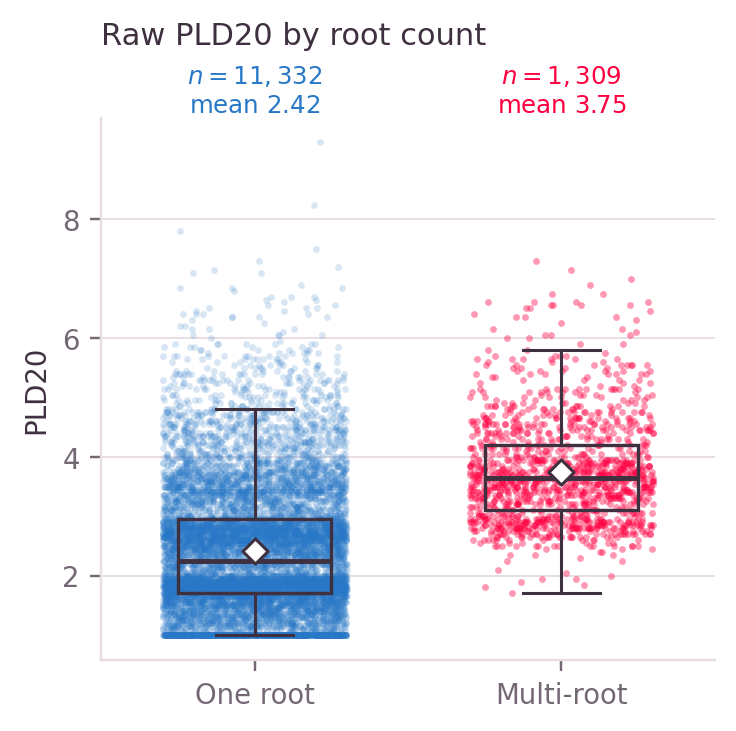
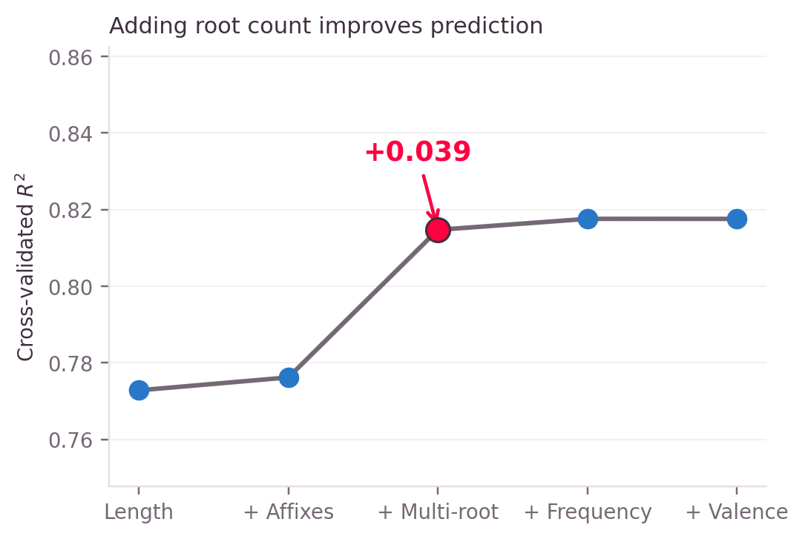
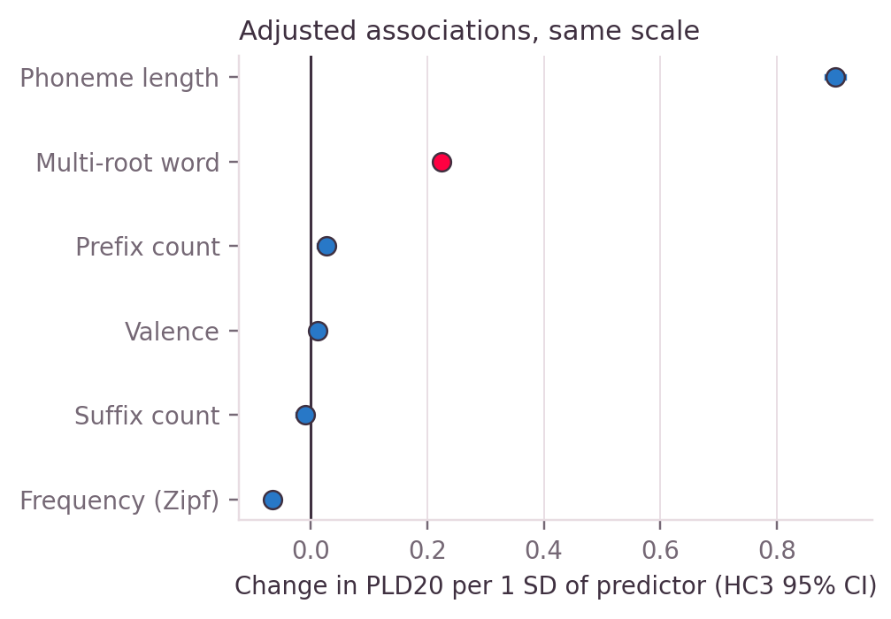
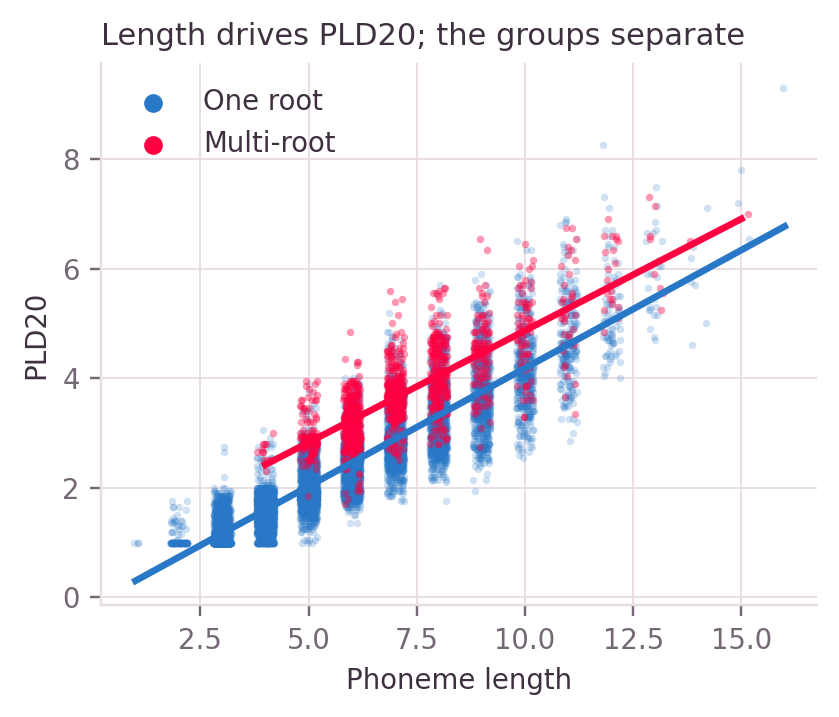

# 🔍 Do Morphological Roots Predict Phonological Neighbourhood Density?

An empirical investigation of how morphological root structure relates to phonological neighbourhood density.

## 🎯 Research Question

Do words with multiple morphological roots have sparser phonological neighbourhoods than single-root words?

Phonological neighbourhood density is measured using **PLD20**, the mean phonological Levenshtein distance to a word's 20 nearest neighbours. Higher PLD20 values indicate sparser phonological neighbourhoods.

## 📊 Key Findings

- **12,641** complete observations analysed
- **β = 0.736**, *p* < .001 for multiple-root words (95% CI [0.702, 0.770])
- **+0.039** cross-validated R² after adding root structure
- **Final cross-validated R² = 0.818**

The results suggest that morphological root structure provides substantial additional predictive information about phonological neighbourhood density.

## 📈 Visual Results

<table>
  <tr>
    <td width="50%" valign="top">
      <strong>1. Root Structure and PLD20</strong><br>
      
      <p>Comparison of PLD20 between single-root words and words with two or more roots. Multi-root words show a higher mean PLD20.</p>
    </td>
    <td width="50%" valign="top">
      <strong>2. Model Performance</strong><br>
      
      <p>Comparison of cross-validated R² across the five nested regression models. Adding root structure produces the largest improvement.</p>
    </td>
  </tr>
  <tr>
    <td width="50%" valign="top">
      <strong>3. Regression Results</strong><br>
      
      <p>Estimated regression coefficients and 95% confidence intervals for the final model, including the positive association of multi-root status with PLD20.</p>
    </td>
    <td width="50%" valign="top">
      <strong>4. Phoneme Length and PLD20</strong><br>
      
      <p>Relationship between the number of phonemes in a word and its phonological neighbourhood density.</p>
    </td>
  </tr>
</table>

## ⚙️ Methodology

Five nested OLS regression models were estimated:

1. Phoneme length
2. Phoneme length + prefixes and suffixes
3. Previous predictors + morphological root structure
4. Previous predictors + word frequency
5. Previous predictors + emotional valence

**Statistical procedures:**

- HC3 heteroskedasticity-robust standard errors
- 95% confidence intervals
- Five-fold cross-validation with identical folds across all models

The final model controls for phoneme length, prefixes, suffixes, word frequency and valence.

The study is observational. Results indicate associations, not causation.

## 🚀 How to start

1. Clone the repository:
```
   git clone https://github.com/Marc-Maxelon/Morphological-Roots-and-Phonological-Density.git
```

2. Navigate to the project directory:
```
   cd Morphological-Roots-and-Phonological-Density
```

3. Run the analysis pipeline:
```
   python run.py
```

## 📁 Project Structure

```text
├── data/
│   ├── raw/
│   └── processed/
├── src/
│   ├── prepare_data.py
│   ├── analysis.py
│   └── plots.py
├── plots/
│   ├── groups.png
│   ├── scatter.png
│   ├── cv_r2.png
│   └── forest.png
├── results/
├── run.py
├── LICENSE
└── README.md
